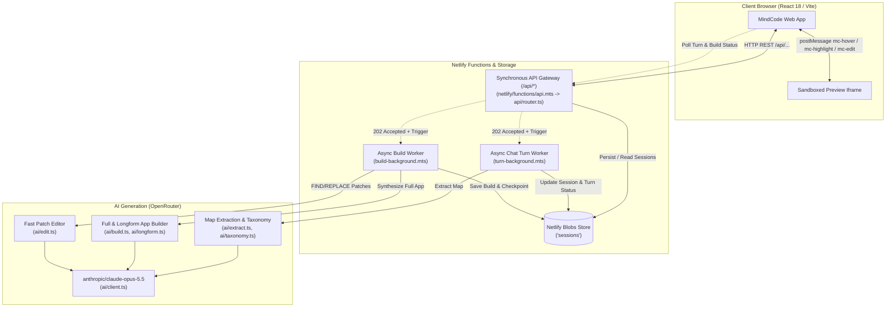

# Architecture

MindCode decomposes conversational application requirements into structured mind maps, extracts implicit AI assumptions, synthesizes standalone single-file web applications, and provides two-way traceability between visual mind map nodes and preview DOM elements.

---

## System Overview



---

## Request Lifecycles

### 1. Chat Turn (Prompt Decomposition & Extraction)
1. **User Message:** The client sends `POST /api/sessions/:sid/messages` with `{ text: string }`.
2. **Synchronous 202 Hand-off:**
   - In production (Netlify), generating a full map plan from Claude Opus (25–35 bubbles across all facets) takes ~40 seconds, exceeding the 30-second synchronous HTTP limit.
   - The API marks `session.turn = { status: "pending", changed: [], started_at: Date.now() }`, persists the session to Blobs, triggers `turn-background.mts`, and returns `202 Accepted` immediately.
   - (In offline fake mode with `MINDCODE_FAKE_LLM=1`, turns complete synchronously and return `200 OK`).
3. **Background Execution (`turn-background.mts`):**
   - Calls `ai.updateMap(messages, currentMap)`.
   - `ai/extract.ts` invokes Claude Opus to generate root goals, four core facets (Design, Audience, Functionality, Cost), and topic nodes with source verification (`user`, `inferred`, `unknown`).
   - Merges newly proposed nodes into the map without overwriting user-approved or locked nodes.
   - Marks `session.turn.status = "done"`, populates `session.turn.changed`, and saves the session to Netlify Blobs.
   - If an error occurs, the turn status is set to `"error"`, the uncommitted user message is rolled back, and the error reason is stored.
4. **Client Polling:** The frontend polls `GET /api/sessions/:sid` every ~1.5–2 seconds until `turn.status !== "pending"`.

---

### 2. Full App Build
1. **Trigger:** The client calls `POST /api/sessions/:sid/build`.
2. **Queueing:**
   - A new build object `{ id: "b1", status: "pending", html: "", trace: {}, checkpoint_id: "cp...", mode: "full" }` is created alongside a corresponding `Checkpoint`.
   - The API returns `202 Accepted` and dispatches `build-background.mts` (which allows up to 15 minutes execution on Netlify).
3. **Synthesis (`ai/build.ts` & `ai/longform.ts`):**
   - Injects the prompt-engineering context and all map nodes into the system prompt.
   - Requires Claude to emit complete, single-file HTML (semantic layout, inline styles, working vanillajs interactions) tagging every structural element with `data-mc="<node_ids>"`.
4. **Completion & Trace Audit:**
   - Once generation finishes, `api/trace.ts` calculates quantitative audit metrics (`BuildAudit`: total elements, traced elements, coverage percentage, node breakdown).
   - The finished build status is set to `"done"` in Blobs.
5. **Client Polling:** The web app polls `GET /api/sessions/:sid/builds/:bid` until status is `"done"`.

---

### 3. Right-Click Targeted Edit & Incremental Rebuilds (`ai/edit.ts`)

#### Right-Click Preview Edit (~7 seconds)
1. **Context Menu Event:** The user right-clicks an element in the sandboxed preview iframe.
2. **Iframe Message:** The injected trace script detects `contextmenu`, highlights the element with `.mc-edit`, and posts `{ type: "mc-edit", el, nodes, snippet, ... }` to the parent React app.
3. **Change Request:** The user types an edit instruction (e.g., *"Make this button deep purple with rounded corners"*).
4. **Targeted Patches (`ai/edit.ts`):**
   - MindCode prompts Claude to return small Git merge-style FIND/REPLACE blocks:
     ```text
     <<<<<<< FIND
     (exact snippet from current HTML)
     =======
     (replacement snippet)
     >>>>>>> REPLACE
     ```
   - `applyPatches` executes exact string replacements against the existing HTML document.
   - **Full-Rewrite Fallback:** If any patch pattern fails to match cleanly or if the output is truncated, the system automatically falls back to full document regeneration (`ai/longform.ts`), guaranteeing the document is never left partially patched.

#### Incremental Rebuild (~20 seconds)
1. When the user modifies only a few bubbles (e.g. adding a child bubble or updating label/detail), the build diff (`mapDiff`) detects a small change (diff size between 1 and `INCREMENTAL_MAX`).
2. Instead of re-synthesizing the entire 30–50 KB HTML application from scratch (which takes 80–120 seconds), `runBuild` marks `mode: "incremental"` and instructs Claude via `editApp` to apply targeted patches based on the diff.

---

### 4. Long-Output Continuation (`ai/longform.ts`)
Complex applications with 25–35 nodes can easily generate 30–50 KB of standalone HTML, occasionally hitting OpenRouter token generation ceilings.
- `ai/longform.ts` inspects output chunks to check if the markup ends with `</html>`.
- If an output is truncated mid-stream, `generateHtml` automatically prompts Claude:
  > *"Your previous message was cut off by the length limit. Continue EXACTLY where it stopped. Output only the remaining characters ending with `</html>`."*
- Stitches consecutive chunks seamlessly across up to `MAX_PARTS = 3` continuations before finalizing.

---

## Data Model

The data structures defined in `api/types.ts` and mirrored in `docs/api-contract.md`:

### `Session`
The central root entity stored in Netlify Blobs (store `sessions`, key = session ID):
```ts
interface Session {
  id: string;
  messages: Message[];
  map: MindMap;
  builds: Build[];
  checkpoints: Checkpoint[];
  node_chats: Record<string, Message[]>;
  turn?: Turn | null;
  next_node_seq?: number;
}
```

### `Node` (`MapNode`)
A unit of design, capability, or open inquiry within the mind map:
```ts
interface MapNode {
  id: string;            // Stable ID: "n1", "n2", ... (monotonically allocated)
  label: string;         // 1-5 words displayed in the bubble
  detail: string;        // One or two explanatory sentences
  kind: "goal" | "feature" | "page" | "component" | "data" | "api" | "style" | "constraint";
  source: "user" | "inferred" | "unknown";
  inventiveness: number; // 0..1 (0 = obvious necessity, 1 = creative leap)
  importance: number;    // 1..5 scale
  status: "proposed" | "approved" | "locked";
  parent: string | null; // Hierarchy parent node ID
  evidence: string[];    // Direct quotes from user input supporting the node
  turn: number;          // Turn number in which it was created
  facet?: "design" | "audience" | "functionality" | "cost" | "goal";
}
```

#### Taxonomy Facets (`facet`)
MindCode organizes apps under four comprehensive facets (plus the root `goal`):
- **Design:** Brand personality, colors, typography, sizing, page structure, usability.
- **Audience:** Target users, market size (TAM/SAM), consumer research.
- **Functionality:** Concrete features, interactive buttons, AI integration, data entities & storage, hosting, scaling.
- **Cost:** External third-party APIs/services, AI token usage, marketing/advertising spend.

### `Build`
A generated application artifact:
```ts
interface Build {
  id: string;            // "b1", "b2", ...
  status: "pending" | "done" | "error";
  error?: string;
  html: string;          // Standalone HTML containing embedded styles and scripts
  trace: Record<string, string[]>; // node_id -> array of element IDs (data-mc-el)
  checkpoint_id: string; // Associated checkpoint snapshot
  mode?: "full" | "incremental" | "edit";
  request?: ChangeRequest;
  audit?: BuildAudit;
}
```

### `Checkpoint`
A point-in-time snapshot of the mind map and corresponding build:
```ts
interface Checkpoint {
  id: string;
  label: string;
  turn: number;
  map: MindMap;
  build_id?: string;
}
```

### `BuildAudit`
Quantitative traceability audit metrics:
```ts
interface BuildAudit {
  totalElements: number;
  tracedElements: number;
  coveragePct: number;
  nodeBreakdown: Record<string, number>;
  untracedNodes: string[];
}
```

---

## Traceability Mechanism

MindCode links high-level intent to concrete code through DOM metadata and an iframe communication bridge:

### 1. Element Tagging
Generated HTML elements contain two attributes:
- `data-mc="n1 n4"`: Space-delimited IDs of the nodes that prompted or shaped the element.
- `data-mc-el="mc-e3"`: A unique element identifier within the build.

### 2. Injected Trace Script (`api/trace.ts`)
The API injects `TRACE_SCRIPT` into preview responses (`/api/sessions/:sid/builds/:bid/preview`):
- **Hovering elements in preview:** Listens for `mouseover` on elements matching `[data-mc]`. Posts `{ type: 'mc-hover', nodes: [...], el: '...' }` to the parent window, causing the mind map to highlight associated bubbles.
- **Hovering/Selecting bubbles in map:** React parent window posts `{ type: 'mc-highlight', nodes: [...] }` to the iframe. The script adds `.mc-hl` to all matching DOM elements and smoothly scrolls the first matching element into view.
- **Right-Click Interaction:** Listens for `contextmenu` events, marks `.mc-edit`, and sends `{ type: 'mc-edit', el, nodes, tag, text, snippet }` to open the inline edit drawer in the React UI.
- **Standalone Download Cleanliness:** When exporting or downloading via `/api/sessions/:sid/builds/:bid/download`, the raw HTML is served without the bridge script or development styles.
